# TD 4 — Les machines à états

=== "Version simplifiée"

    Rappels : [chapitre 4](../cours/chapitre-4-machines-etats.md). Énoncés, graphes
    et corrections du prof : onglet **Version papier** (exercices 1 à 7 du support
    2026-2027). L'entrée s'appelle $b$, la sortie $S$, les états $E_0, E_1, \dots$

    ## Exercice 1 — Détecter les fronts descendants de $b$ : Moore contre Mealy

    On veut une sortie à 1 à chaque transition $b : 1 \to 0$. Deux bascules D, même
    horloge, même entrée $b$.

    ### 1-a. Machine A (Moore)

    | État | Signification | $Q_1Q_0$ | $S$ |
    |:-:|---|:-:|:-:|
    | $E_0$ | $b$ vaut 0 depuis au moins un top | 00 | 0 |
    | $E_1$ | $b$ vaut 1 | 01 | 0 |
    | $E_2$ | $b$ vient de passer à 0 : front détecté | 10 | **1** |

    | Présent $Q_1Q_0$ | Futur si $b = 0$ | Futur si $b = 1$ | $S$ |
    |:-:|:-:|:-:|:-:|
    | $E_0$ = 00 | 00 | 01 | 0 |
    | $E_1$ = 01 | 10 | 01 | 0 |
    | $E_2$ = 10 | 00 | 01 | 1 |

    Avec l'état 11 en X :

    $$
    D_0 = b, \qquad D_1 = \overline{b}\,Q_0, \qquad S = Q_1
    $$

    **Logigramme en NOR** : $D_1 = \overline{b}\,Q_0 = \overline{b + \overline{Q_0}}$,
    une seule NOR (7402) qui reçoit $b$ et $\overline{Q_0}$.

    ### 1-b. Machine B (Mealy)

    En Mealy, la sortie est portée par la transition : $S = 1$ sur la transition
    $E_1 \to$ quand $b = 0$. Les lignes de $E_0$ et $E_2$ de la table sont alors
    **identiques** (mêmes futurs, mêmes sorties) : on les fusionne, il ne reste que
    **deux états**.

    | Présent $Q_0$ | $b = 0$ : futur / $S$ | $b = 1$ : futur / $S$ |
    |:-:|:-:|:-:|
    | $E_0$ = 0 | $E_0$ / 0 | $E_1$ / 0 |
    | $E_1$ = 1 | $E_0$ / **1** | $E_1$ / 0 |

    $$
    D_0 = b, \qquad S = \overline{b}\,Q_0
    $$

    Une seule bascule suffit, et $S$ est exactement la sortie de la **NOR** du
    circuit de A : on prélève la sortie de B à la sortie de la porte 7402.

    ### 1-c. Chronogramme de test

    - $S_{Mealy} = \overline{b}\,Q_0$ passe à 1 **dès que $b$ tombe**, sans attendre
      l'horloge, et retombe au front suivant (quand $Q_0$ recopie $b = 0$). Sa durée
      dépend de l'instant où $b$ change : elle est **asynchrone**.
    - $S_{Moore} = Q_1$ passe à 1 au front **suivant** et dure **exactement une
      période** d'horloge : elle est **synchrone**, mais en retard.

    !!! piege "La conclusion attendue"
        Moore et Mealy se distinguent par leurs sorties : synchrones pour Moore,
        asynchrones pour Mealy. Mealy réagit plus tôt et demande moins d'états,
        Moore donne une sortie propre et calée sur l'horloge.

    ## Exercice 2 — Machine de Moore pour 5 LEDs

    **3 sorties suffisent** : sur toute la séquence, $L_1$ et $L_5$ sont toujours
    dans le même état, $L_2$ et $L_4$ aussi. On garde $L_1 = L_5$, $L_2 = L_4$ et $L_3$.

    **5 états → 3 bascules D** ($2^3 = 8 \geq 5$), $E_k$ codé par $k$ en binaire.
    $b = 1$ → maintien, $b = 0$ → état suivant.

    | État $Q_2Q_1Q_0$ | Futur si $b = 0$ | Futur si $b = 1$ | $L_1 = L_5$ | $L_2 = L_4$ | $L_3$ |
    |:-:|:-:|:-:|:-:|:-:|:-:|
    | $E_0$ = 000 | 001 | 000 | 1 | 1 | 1 |
    | $E_1$ = 001 | 010 | 001 | 1 | 0 | 0 |
    | $E_2$ = 010 | 011 | 010 | 0 | 1 | 0 |
    | $E_3$ = 011 | 100 | 011 | 1 | 0 | 1 |
    | $E_4$ = 100 | 000 | 100 | 0 | 0 | 0 |

    Après Karnaugh (états 101, 110, 111 en X) :

    $$
    \begin{aligned}
    D_0 &= b\,Q_0 + \overline{b}\,\overline{Q_2}\,\overline{Q_0} \\
    D_1 &= Q_1\overline{Q_0} + b\,Q_1 + \overline{b}\,\overline{Q_1}\,Q_0 \\
    D_2 &= b\,Q_2 + \overline{b}\,Q_1 Q_0
    \end{aligned}
    $$

    $$
    L_1 = L_5 = Q_0 + \overline{Q_2}\,\overline{Q_1}, \qquad
    L_2 = L_4 = \overline{Q_2}\,\overline{Q_0}, \qquad
    L_3 = Q_1 Q_0 + \overline{Q_2}\,\overline{Q_1}\,\overline{Q_0}
    $$

    !!! methode "Lire une équation d'entrée D"
        Chaque équation répond à « quand est-ce que ce bit vaut 1 à l'état suivant ? ».
        Pour $D_2$ : soit on reste ($b = 1$) et $Q_2$ valait déjà 1, soit on avance
        ($b = 0$) depuis $E_3 = 011$, le seul état qui mène à un état avec $Q_2 = 1$.

    ## Exercice 3 — Détecteur de `010` en Moore, bascules D

    | État | Signification | $Q_1Q_0$ | $S$ |
    |:-:|---|:-:|:-:|
    | $E_0$ | rien d'utile | 00 | 0 |
    | $E_1$ | reçu `0` | 01 | 0 |
    | $E_2$ | reçu `01` | 10 | 0 |
    | $E_3$ | reçu `010` | 11 | **1** |

    Table de la correction du prof :

    | Présent $Q_1Q_0$ | Futur si $b = 0$ | Futur si $b = 1$ | $S$ |
    |:-:|:-:|:-:|:-:|
    | $E_0$ = 00 | $E_1$ = 01 | $E_0$ = 00 | 0 |
    | $E_1$ = 01 | $E_1$ = 01 | $E_2$ = 10 | 0 |
    | $E_2$ = 10 | $E_3$ = 11 | $E_0$ = 00 | 0 |
    | $E_3$ = 11 | $E_1$ = 01 | $E_0$ = 00 | 1 |

    $$
    D_0 = \overline{b}, \qquad D_1 = b\,\overline{Q_1}\,Q_0 + \overline{b}\,Q_1\overline{Q_0}, \qquad S = Q_1 Q_0
    $$

    !!! piege "Le chevauchement depuis $E_3$"
        Après `010`, le dernier `0` peut commencer une nouvelle séquence : avec $b = 0$
        on retourne en $E_1$ (et pas en $E_0$). La correction du prof renvoie en $E_0$
        quand $b = 1$. Si on veut aussi détecter `01010` deux fois, il faut aller en
        $E_2$ (on a reçu `01`). On obtient alors $D_1 = b\,Q_0 + \overline{b}\,Q_1\overline{Q_0}$,
        avec $D_0$ et $S$ inchangés. Suivre la convention du prof à l'examen.

    ## Exercices 4 et 5 — Même détecteur en Moore, JK telles que $J = K$

    Le support donne le même énoncé deux fois (p. 28 et 29) : même graphe et même
    table qu'à l'exercice 3. Une JK avec $J = K$ est une bascule T :
    $J_i = K_i = Q_i \oplus Q_i^+$ (1 quand le bit doit changer).

    | Présent $Q_1Q_0$ | Futur $b = 0$ | Futur $b = 1$ | $J_0 = K_0$ ($b = 0$ / $b = 1$) | $J_1 = K_1$ ($b = 0$ / $b = 1$) |
    |:-:|:-:|:-:|:-:|:-:|
    | 00 | 01 | 00 | 1 / 0 | 0 / 0 |
    | 01 | 01 | 10 | 0 / 1 | 0 / 1 |
    | 10 | 11 | 00 | 1 / 0 | 0 / 1 |
    | 11 | 01 | 00 | 0 / 1 | 1 / 1 |

    $$
    J_0 = K_0 = \overline{b \oplus Q_0}, \qquad
    J_1 = K_1 = b\,(Q_1 \oplus Q_0) + Q_1 Q_0, \qquad
    S = Q_1 Q_0
    $$

    ## Exercice 6 — Détecteur de `010` en Mealy, bascules D

    On part du graphe de Moore à 4 états, puis on porte la sortie sur les
    transitions : $S = 1$ quand on reçoit $b = 0$ depuis $E_2$ (`01` déjà reçu).
    $E_3$ devient inutile, il reste **trois états** :

    | Présent $Q_1Q_0$ | $b = 0$ : futur / $S$ | $b = 1$ : futur / $S$ |
    |:-:|:-:|:-:|
    | $E_0$ = 00 | $E_1$ = 01 / 0 | $E_0$ = 00 / 0 |
    | $E_1$ = 01 | $E_1$ = 01 / 0 | $E_2$ = 10 / 0 |
    | $E_2$ = 10 | $E_0$ = 00 / **1** | $E_0$ = 00 / 0 |

    Avec l'état 11 en X :

    $$
    D_0 = \overline{b}\,\overline{Q_1}, \qquad D_1 = b\,Q_0, \qquad S = \overline{b}\,Q_1
    $$

    **Bilan** : un état de moins qu'en Moore. En contrepartie, $S$ dépend directement
    de $b$ : elle change dès que $b$ change, sans attendre l'horloge.

    !!! piege "Variante avec chevauchement"
        Si, depuis $E_2$ avec $b = 0$, on va en $E_1$ (le dernier `0` reçu peut
        recommencer une séquence), on obtient $D_0 = \overline{b}$, $D_1 = b\,Q_0$
        et toujours $S = \overline{b}\,Q_1$.

    ## Exercice 7 — Même détecteur en Mealy, JK telles que $J = K$

    Même table qu'à l'exercice 6, avec $J_i = K_i = Q_i \oplus Q_i^+$ :

    $$
    J_0 = K_0 = b\,Q_0 + \overline{b}\,\overline{Q_1}\,\overline{Q_0}, \qquad
    J_1 = K_1 = b\,Q_0 + Q_1, \qquad
    S = \overline{b}\,Q_1
    $$

=== "Version papier"

    Énoncés 2026-2027, tirés du support du chapitre 4 (D. Achvar). Le support étudiant contient aussi les étapes de correction du prof : on garde l'énoncé puis la page la plus complète de chaque correction.

    [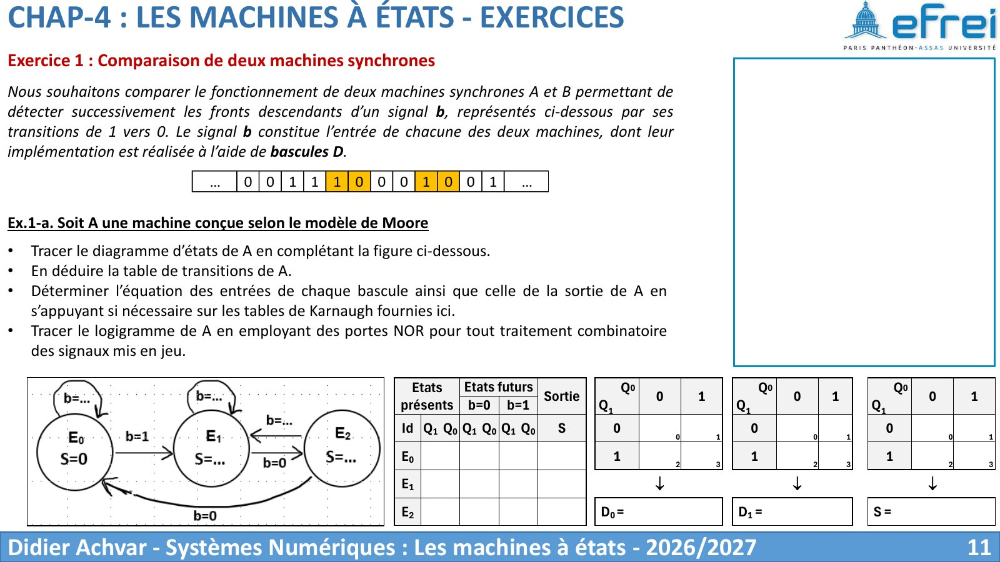{ loading=lazy .papier }](papier/td4/mae-p11.jpg)
    
Exercice 1-a — machine A (Moore) : énoncé · Chapitre 4 — Les machines à états (2026-2027), p. 11

    [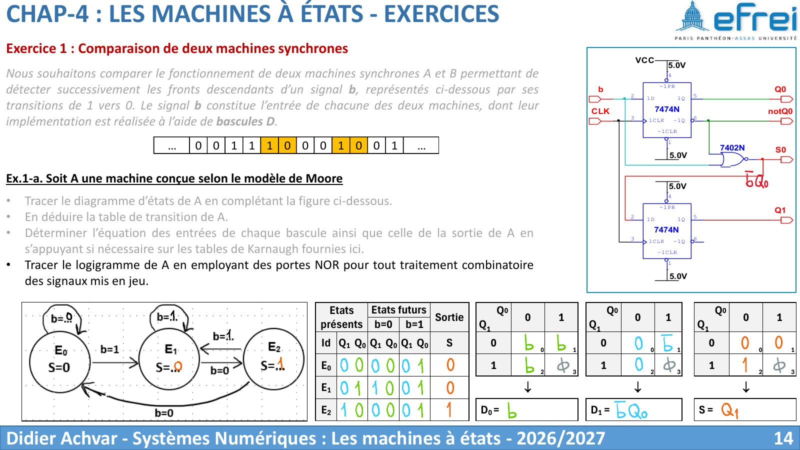{ loading=lazy .papier }](papier/td4/mae-p14.jpg)
    
Exercice 1-a — machine A : correction · Chapitre 4 — Les machines à états (2026-2027), p. 14

    [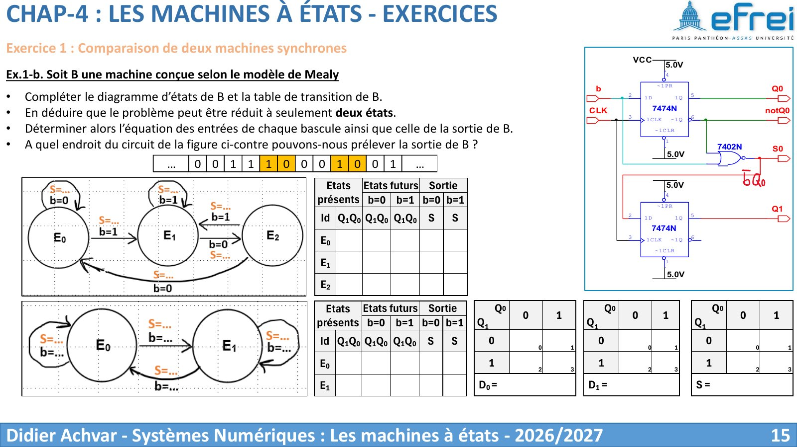{ loading=lazy .papier }](papier/td4/mae-p15.jpg)
    
Exercice 1-b — machine B (Mealy) : énoncé · Chapitre 4 — Les machines à états (2026-2027), p. 15

    [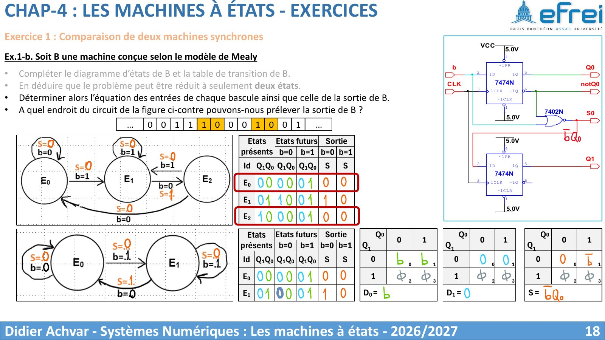{ loading=lazy .papier }](papier/td4/mae-p18.jpg)
    
Exercice 1-b — machine B réduite à 2 états : correction · Chapitre 4 — Les machines à états (2026-2027), p. 18

    [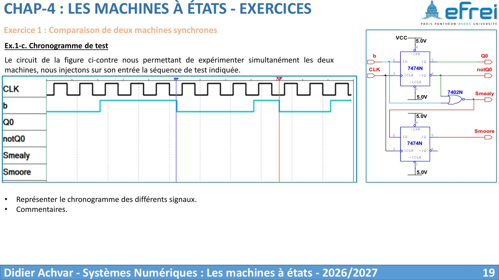{ loading=lazy .papier }](papier/td4/mae-p19.jpg)
    
Exercice 1-c — chronogramme de test : énoncé · Chapitre 4 — Les machines à états (2026-2027), p. 19

    [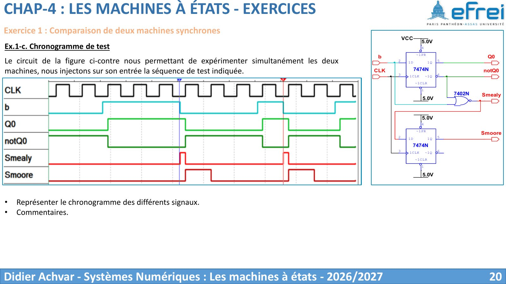{ loading=lazy .papier }](papier/td4/mae-p20.jpg)
    
Exercice 1-c — chronogramme de test : correction · Chapitre 4 — Les machines à états (2026-2027), p. 20

    [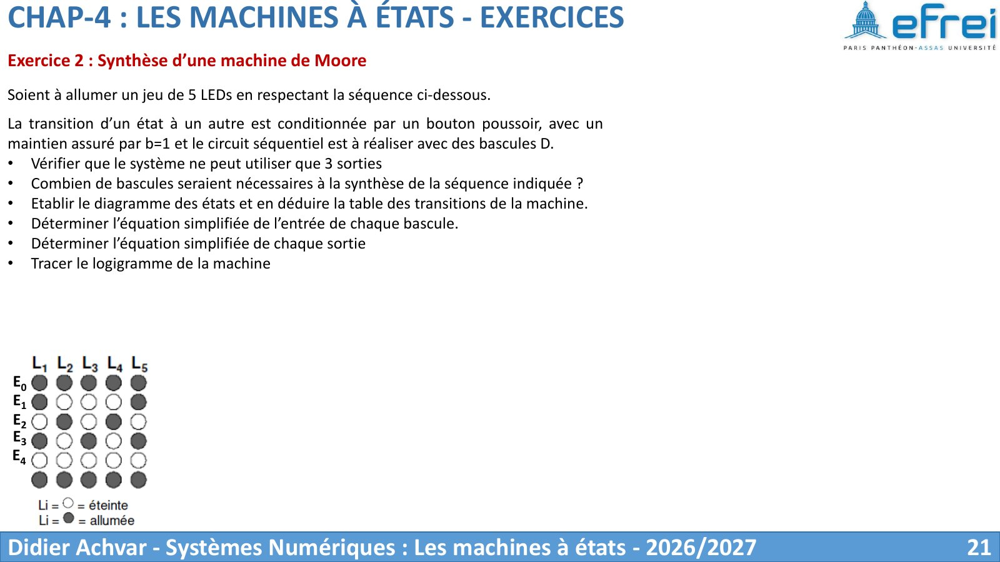{ loading=lazy .papier }](papier/td4/mae-p21.jpg)
    
Exercice 2 — 5 LEDs en Moore : énoncé · Chapitre 4 — Les machines à états (2026-2027), p. 21

    [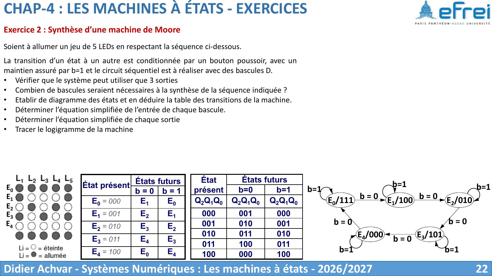{ loading=lazy .papier }](papier/td4/mae-p22.jpg)
    
Exercice 2 — diagramme et table des états · Chapitre 4 — Les machines à états (2026-2027), p. 22

    [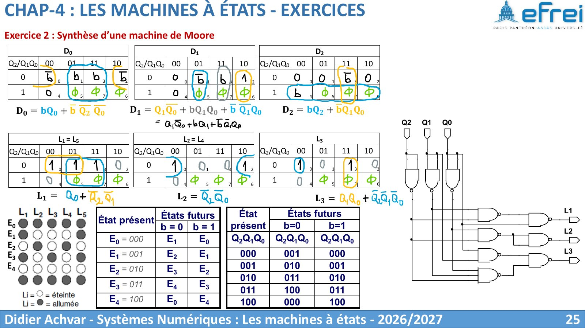{ loading=lazy .papier }](papier/td4/mae-p25.jpg)
    
Exercice 2 — Karnaugh et logigramme · Chapitre 4 — Les machines à états (2026-2027), p. 25

    [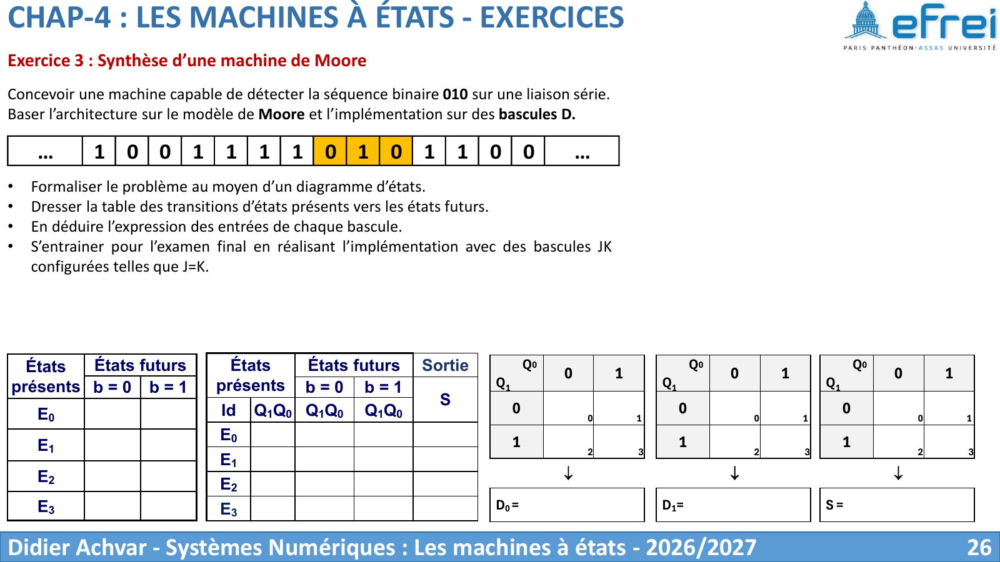{ loading=lazy .papier }](papier/td4/mae-p26.jpg)
    
Exercice 3 — détecteur de 010 en Moore (D) : énoncé · Chapitre 4 — Les machines à états (2026-2027), p. 26

    [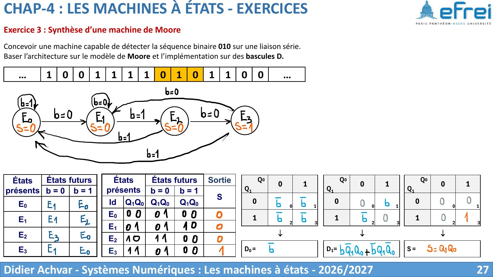{ loading=lazy .papier }](papier/td4/mae-p27.jpg)
    
Exercice 3 — correction · Chapitre 4 — Les machines à états (2026-2027), p. 27

    [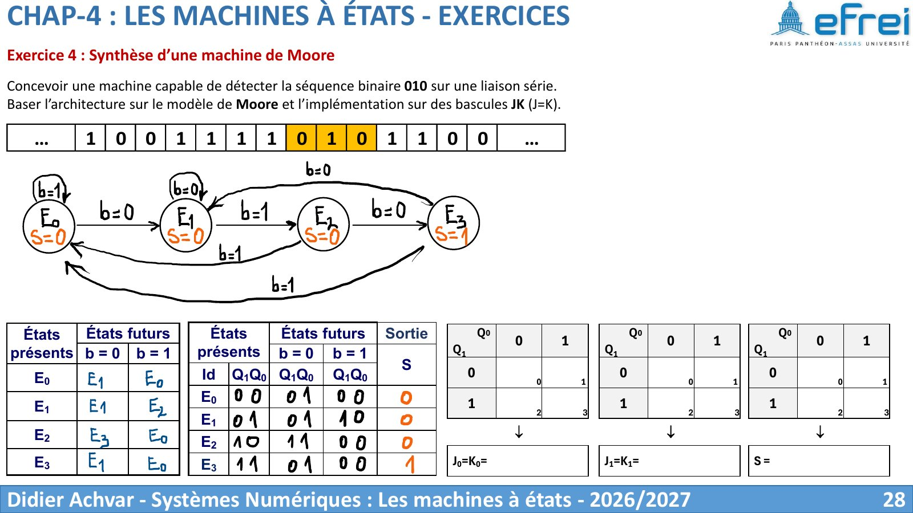{ loading=lazy .papier }](papier/td4/mae-p28.jpg)
    
Exercice 4 — détecteur de 010 en Moore (JK, J = K) : énoncé · Chapitre 4 — Les machines à états (2026-2027), p. 28

    [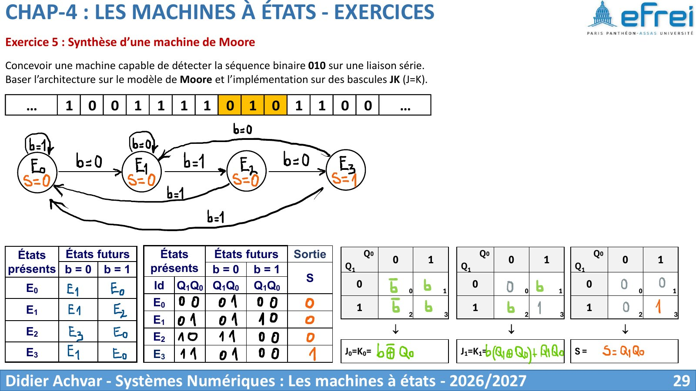{ loading=lazy .papier }](papier/td4/mae-p29.jpg)
    
Exercices 4 et 5 — correction en JK · Chapitre 4 — Les machines à états (2026-2027), p. 29

    [{ loading=lazy .papier }](papier/td4/mae-p30.jpg)
    
Exercice 6 — détecteur de 010 en Mealy (D) : énoncé · Chapitre 4 — Les machines à états (2026-2027), p. 30

    [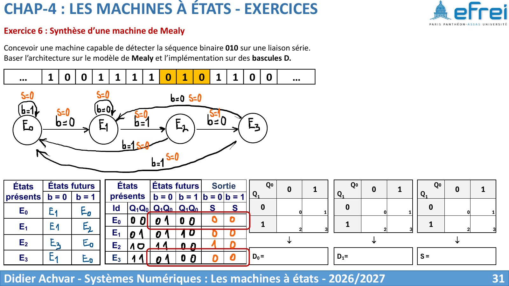{ loading=lazy .papier }](papier/td4/mae-p31.jpg)
    
Exercice 6 — graphe à 4 états · Chapitre 4 — Les machines à états (2026-2027), p. 31

    [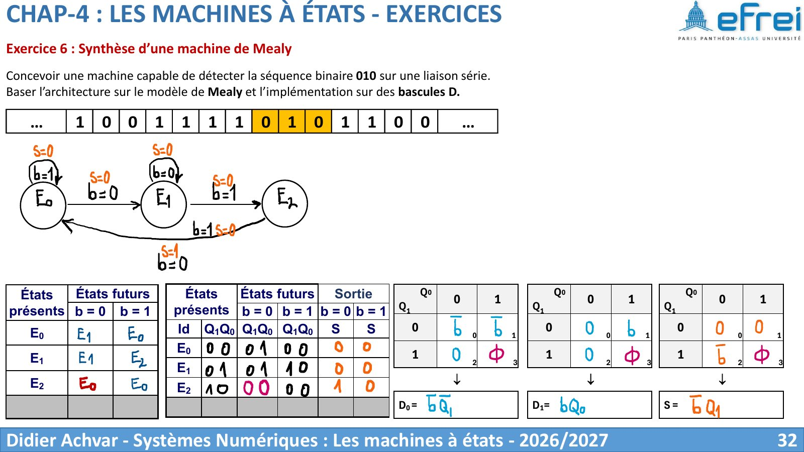{ loading=lazy .papier }](papier/td4/mae-p32.jpg)
    
Exercice 6 — graphe réduit à 3 états : correction · Chapitre 4 — Les machines à états (2026-2027), p. 32

    [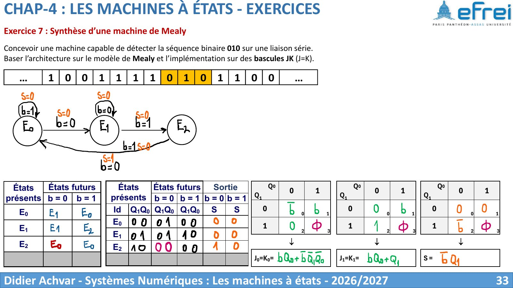{ loading=lazy .papier }](papier/td4/mae-p33.jpg)
    
Exercice 7 — détecteur de 010 en Mealy (JK, J = K) : correction · Chapitre 4 — Les machines à états (2026-2027), p. 33

