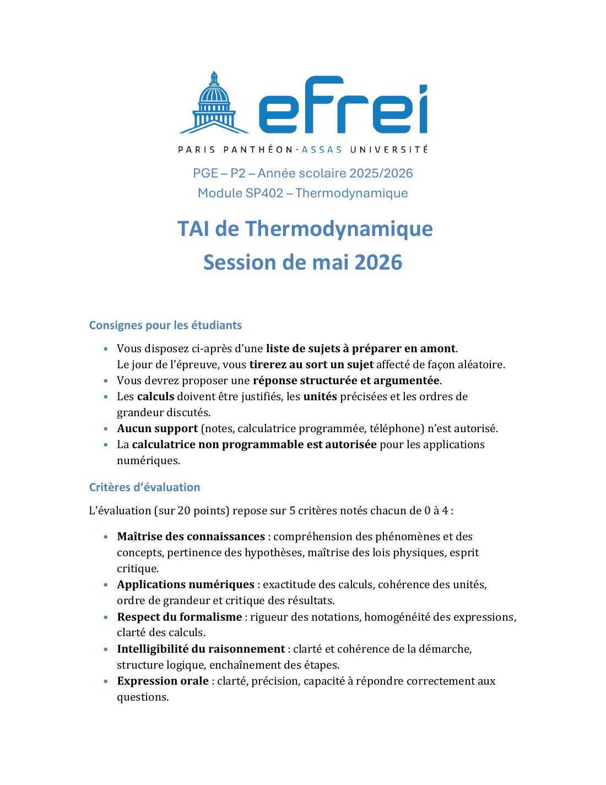
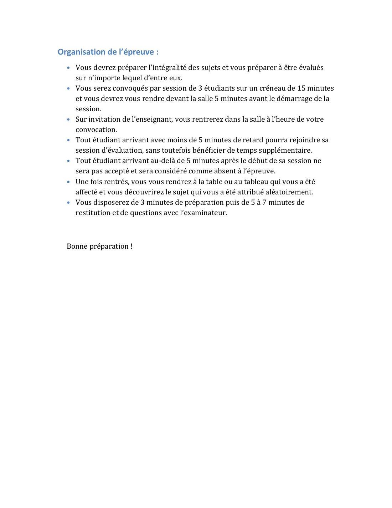
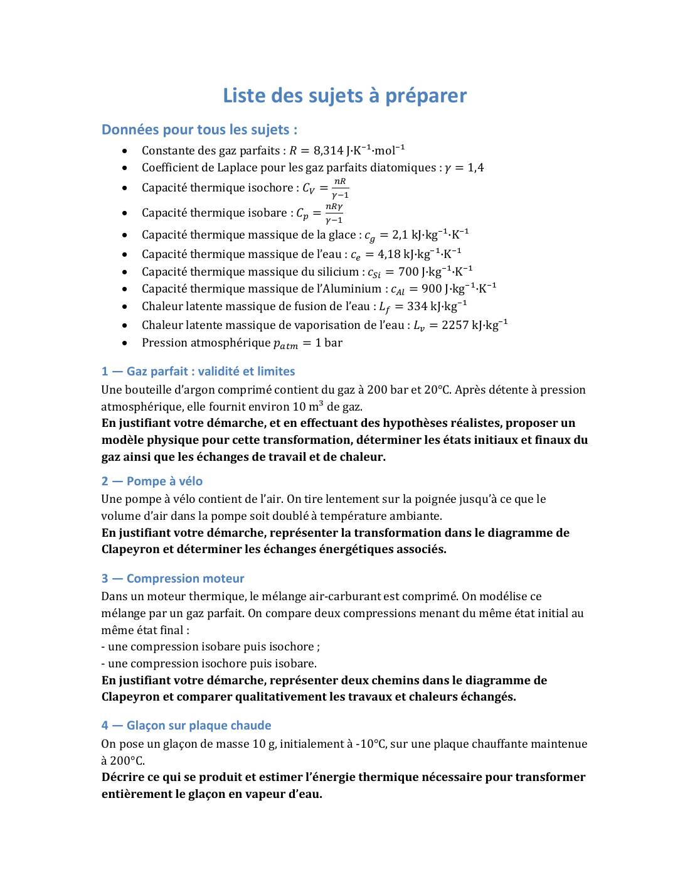
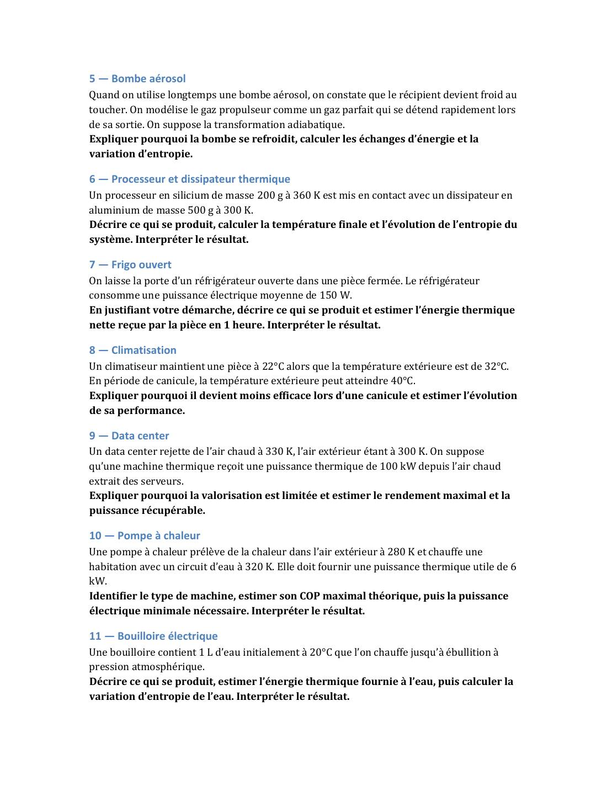
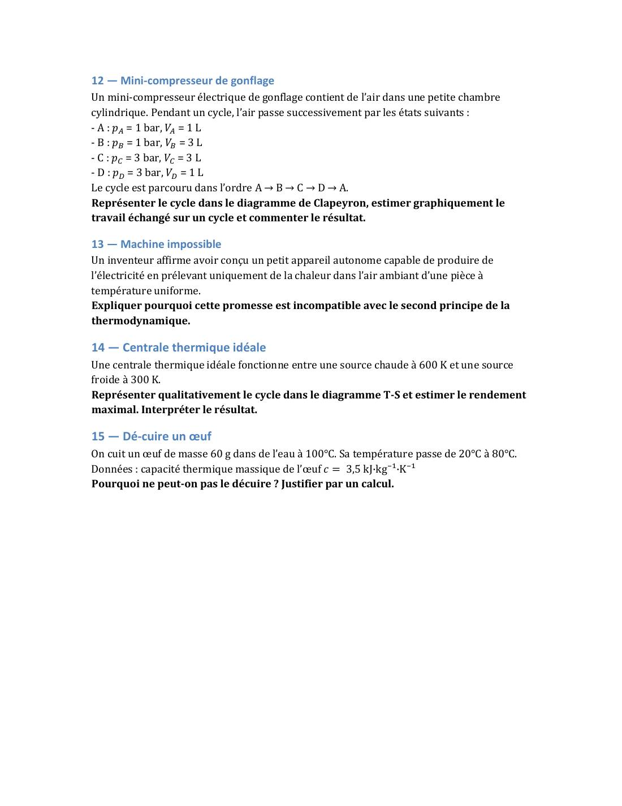

# Travaux d'autonomie et d'initiative (TAI)

=== "Version simplifiée"

    Le TAI compte pour **10 %** de la note (le DE pèse 60 % et les interrogations de TD 30 %).

    !!! methode "Déroulement de l'épreuve (mai 2026)"
        - Tous les sujets de la liste sont à **préparer à l'avance** : on en tire un au sort.
        - Sessions de 3 étudiants, convocation 5 minutes avant.
        - **3 minutes de préparation**, puis **5 à 7 minutes** de restitution et de questions.
        - Aucun support ; calculatrice non programmable autorisée.

    Notation sur 20 : cinq critères notés de 0 à 4 (connaissances, applications
    numériques, formalisme, clarté du raisonnement, expression orale).

    !!! tip "Pour préparer"
        Chaque sujet ressemble à un exercice de TD : refaire les
        [TD](../td/index.md) et apprendre la [fiche](../fiches/fiche-thermo.md).
        Penser à annoncer les hypothèses, vérifier l'homogénéité et commenter
        l'ordre de grandeur du résultat.

=== "Version papier"

    La liste des sujets à préparer (le planning des sessions, qui contient les noms des étudiants, n'est pas publié : il est sur Moodle).

    <!-- papier: pdf/SP402P/2526sp402-tai-sujets-etudiants.pdf | TAI — liste des sujets | sujets | page -->

    [{ loading=lazy .papier }](papier/sujets/p01.jpg)
    
Module SP402 – Thermodynamique · TAI — liste des sujets, page 1

    [{ loading=lazy .papier }](papier/sujets/p02.jpg)
    
Organisation de l’épreuve : · TAI — liste des sujets, page 2

    [{ loading=lazy .papier }](papier/sujets/p03.jpg)
    
Liste des sujets à préparer · TAI — liste des sujets, page 3

    [{ loading=lazy .papier }](papier/sujets/p04.jpg)
    
5 — Bombe aérosol · TAI — liste des sujets, page 4

    [{ loading=lazy .papier }](papier/sujets/p05.jpg)
    
12 — Mini-compresseur de gonflage · TAI — liste des sujets, page 5

    <!-- /papier -->
