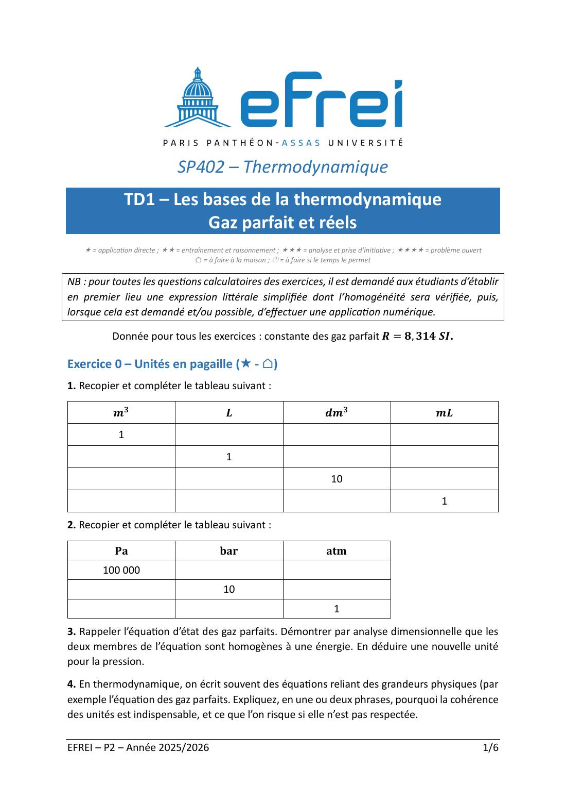
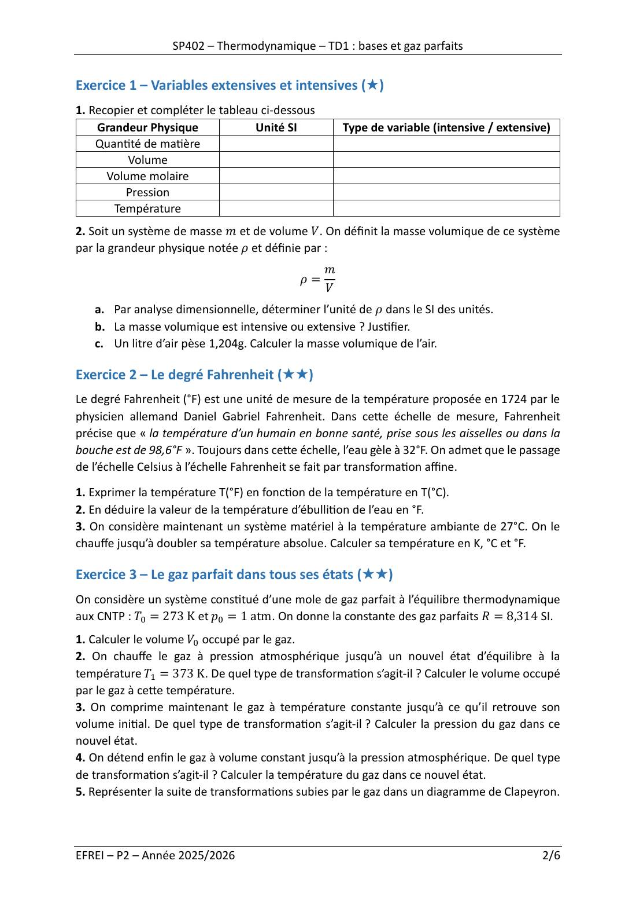
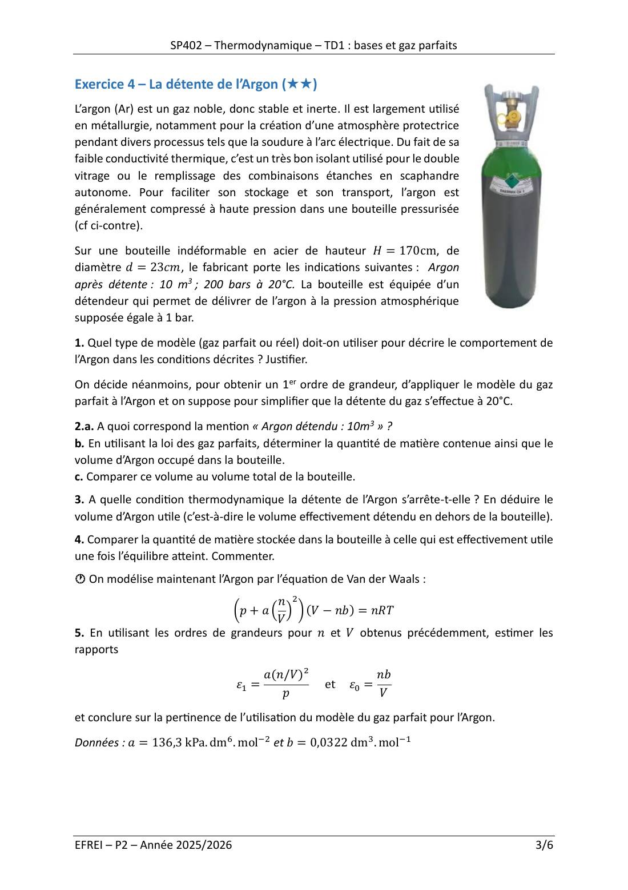
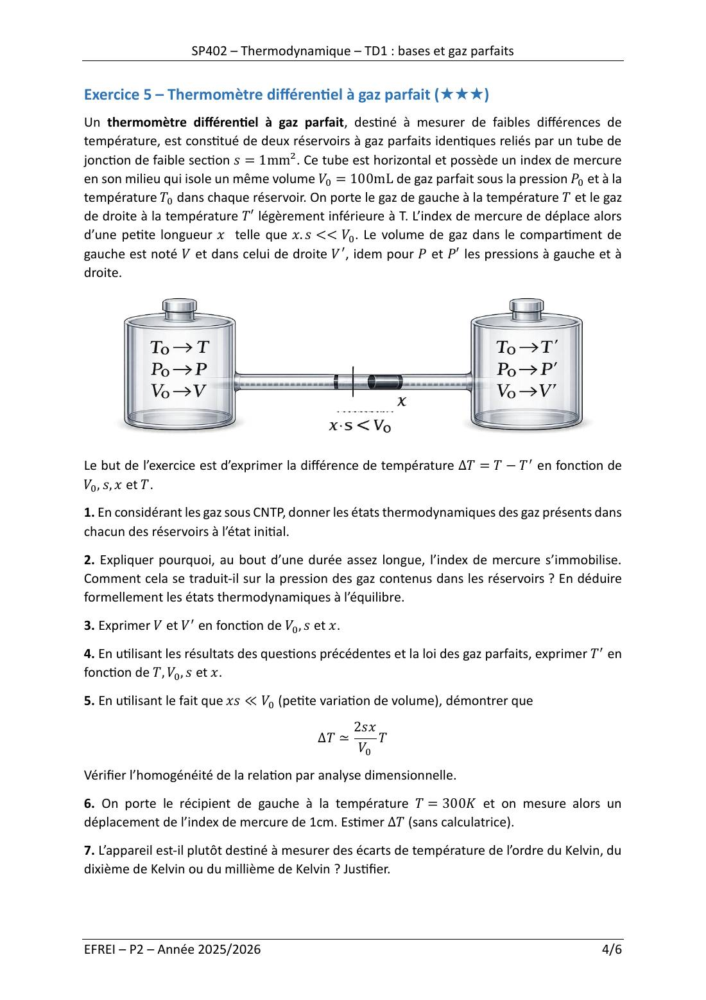
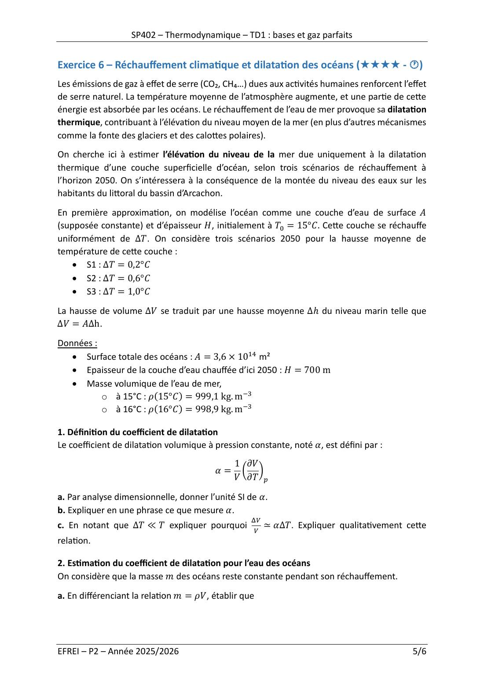
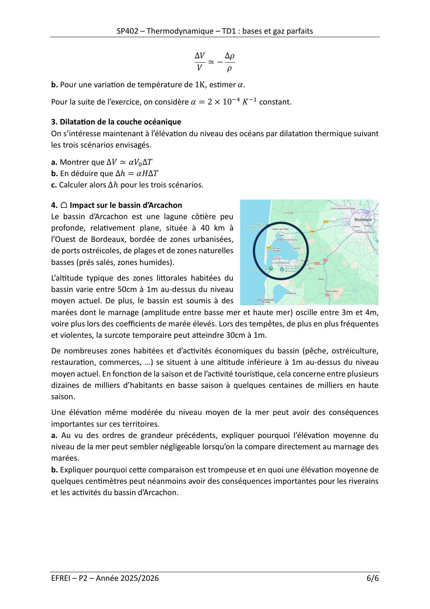

# TD 1 — Les bases : gaz parfaits et gaz réels

=== "Version simplifiée"

    Rappels : [chapitre 1](../cours/chapitre-1-bases.md). Toujours : expression
    littérale, homogénéité, **puis** application numérique en unités SI.

    ## Exercices 0 à 2 — Unités, variables, températures

    - 1 m³ = 1000 L = 1000 dm³ = $10^6$ mL ; 1 bar = $10^5$ Pa ; 1 atm = 101 325 Pa.
    - $pV = nRT$ : Pa·m³ = N·m = J, donc **1 Pa = 1 J/m³** (une pression est une énergie volumique).
    - Extensives : $n$ (mol), $V$ (m³). Intensives : volume molaire (m³/mol), $p$ (Pa), $T$ (K).
    - $\rho = m/V$ (kg/m³) est **intensive** (quotient de deux extensives). Air : $\rho = 1{,}204$ kg/m³.
    - Fahrenheit : $T(°\text{F}) = 1{,}8\,T(°\text{C}) + 32$ ; l'eau bout à 212 °F.
      Doubler la température **absolue** de 27 °C : 300 K → 600 K = 327 °C = 620,6 °F.

    ## Exercice 3 — Une mole de gaz parfait

    1. $V_0 = RT_0/p_0 \approx 22{,}4$ L.
    2. Chauffage à $p$ constante : **isobare**, $V_1 = V_0\,T_1/T_0 \approx 30{,}6$ L.
    3. Compression à $T$ constante : **isotherme**, $p_2 = p_0\,V_1/V_0 = 1{,}37$ atm.
    4. Retour à $p_0$ à volume constant : **isochore**, $T_3 = T_1\,p_0/p_2 = 273$ K : on est revenu à l'état initial (cycle).

    ## Exercice 4 — La bouteille d'argon

    1. À 200 bar, le gaz est **réel** (molécules proches, interactions non négligeables).
    2. « 10 m³ » = volume occupé par le gaz **détendu** à 1 bar et 20 °C.
       $n = \dfrac{p_{atm}V}{RT} \approx 410$ mol, qui occupent dans la bouteille
       $V = \dfrac{nRT}{200\ \text{bar}} = 50$ L (bouteille d'environ 70 L hors tout).
    3. La détente s'arrête quand la pression dans la bouteille vaut 1 bar :
       il reste 50 L de gaz dedans, le volume utile est $\approx 9{,}95$ m³.
    4. Il reste $\approx 2$ mol sur 410 (0,5 %) : presque tout le gaz est utilisable.
    5. Avec $n/V \approx 8{,}2\cdot10^3$ mol/m³ : $\varepsilon_1 \approx 0{,}46$ et
       $\varepsilon_0 \approx 0{,}26$, pas petits devant 1 : le gaz parfait ne donne
       qu'un **ordre de grandeur** à 200 bar.

    ## Exercice 5 — Thermomètre différentiel

    À l'équilibre, l'index s'arrête quand **$p = p'$**. $V = V_0 + sx$, $V' = V_0 - sx$,
    même $n$ des deux côtés : $\dfrac{T'}{T} = \dfrac{V_0 - sx}{V_0 + sx}$, d'où pour $sx \ll V_0$ :

    $$
    \Delta T \approx \frac{2sx}{V_0}\,T
    $$

    AN : $\Delta T = \frac{2\times10^{-6}\times10^{-2}}{10^{-4}}\times300 = 0{,}06$ K :
    l'appareil mesure des écarts de l'ordre du **centième de kelvin**.

    ## Exercice 6 — Dilatation des océans

    - $\alpha$ en K⁻¹ : variation relative de volume par kelvin à $p$ constante.
    - $m = \rho V$ constante → $\dfrac{\Delta V}{V} \approx -\dfrac{\Delta\rho}{\rho}$ ; entre 15 et 16 °C : $\alpha \approx 2\cdot10^{-4}$ K⁻¹.
    - $\Delta V = \alpha V_0\Delta T$ et $V_0 = AH$, $\Delta V = A\,\Delta h$ → $\Delta h = \alpha H\Delta T$.
    - $\Delta h \approx$ **2,8 cm**, **8,4 cm** et **14 cm** pour les trois scénarios.
    - Petit devant le marnage (3–4 m), mais c'est une élévation **permanente du niveau
      moyen** qui s'ajoute à chaque marée haute et surcote de tempête : les zones
      basses (< 1 m) sont inondées plus souvent.

=== "Version papier"

    Énoncé du TD 1 tel qu'il est distribué.

    <!-- papier: pdf/SP402P/td1.pdf | TD 1 — énoncé | td1 | page -->

    [{ loading=lazy .papier }](papier/td1/p01.jpg)
    
SP402 – Thermodynamique · TD 1 — énoncé, page 1

    [{ loading=lazy .papier }](papier/td1/p02.jpg)
    
Exercice 1 – Variables extensives et intensives () · TD 1 — énoncé, page 2

    [{ loading=lazy .papier }](papier/td1/p03.jpg)
    
Exercice 4 – La détente de l’Argon () · TD 1 — énoncé, page 3

    [{ loading=lazy .papier }](papier/td1/p04.jpg)
    
Exercice 5 – Thermomètre différentiel à gaz parfait () · TD 1 — énoncé, page 4

    [{ loading=lazy .papier }](papier/td1/p05.jpg)
    
Exercice 6 – Réchauffement climatique et dilatation des océans ( - ) · TD 1 — énoncé, page 5

    [{ loading=lazy .papier }](papier/td1/p06.jpg)
    
3. Dilatation de la couche océanique · TD 1 — énoncé, page 6

    <!-- /papier -->
