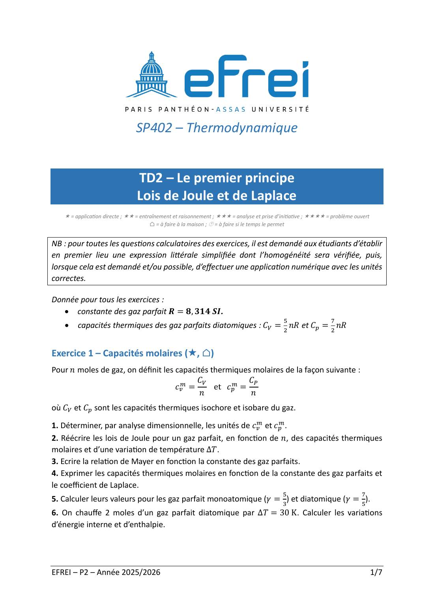
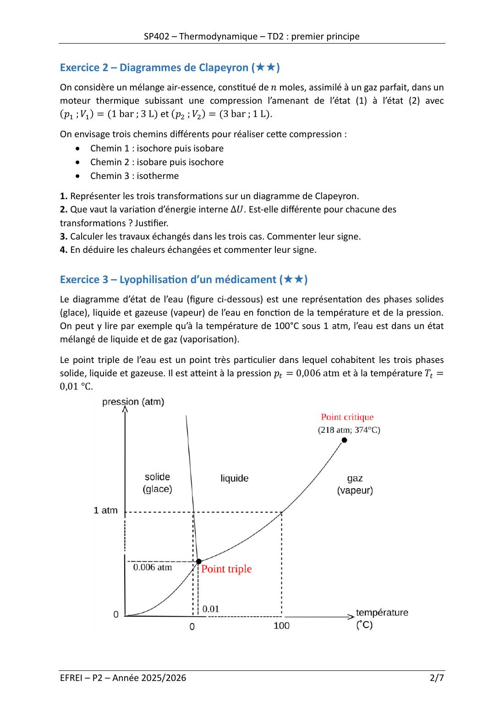
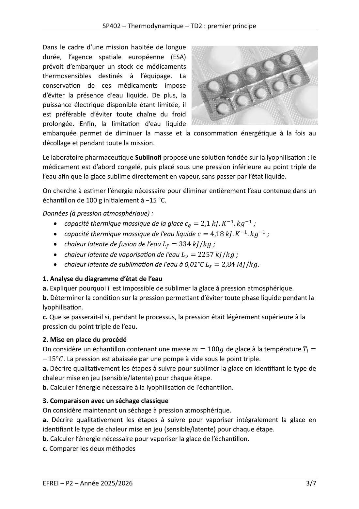
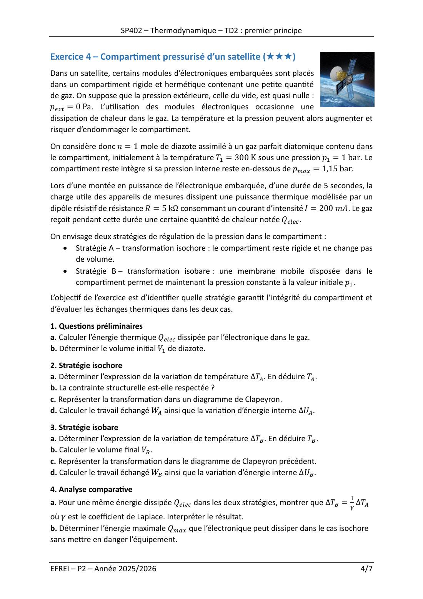
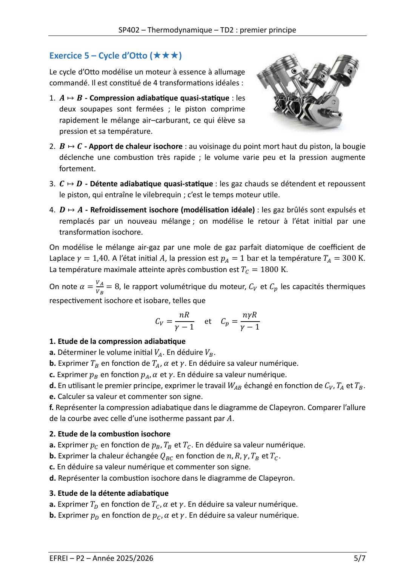
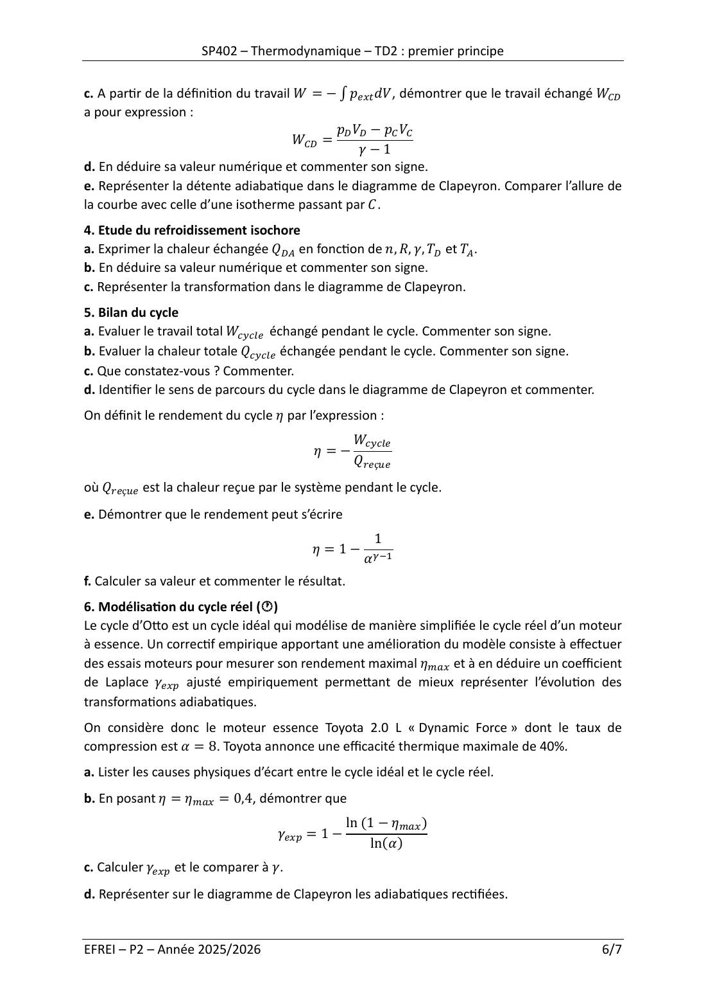
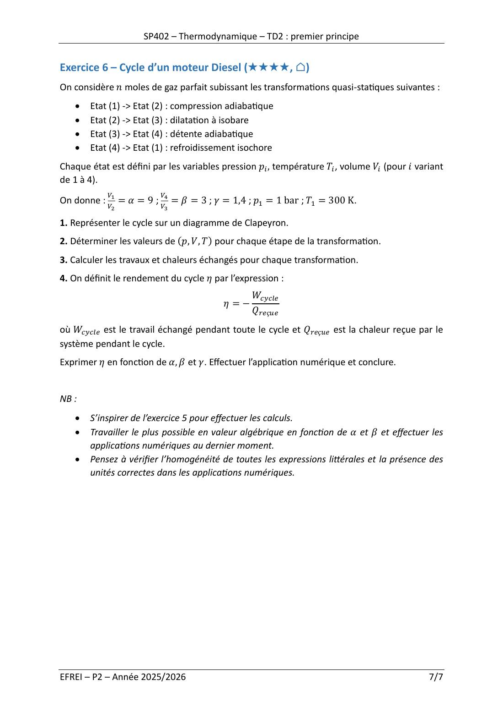

# TD 2 — Le premier principe : lois de Joule et de Laplace

=== "Version simplifiée"

    Rappels : [chapitre 2](../cours/chapitre-2-premier-principe.md).

    ## Exercice 1 — Capacités molaires

    $c_{vm}$, $c_{pm}$ en J·K⁻¹·mol⁻¹ ; $\Delta U = n\,c_{vm}\Delta T$, $\Delta H = n\,c_{pm}\Delta T$,
    Mayer : $c_{pm} - c_{vm} = R$, d'où $c_{vm} = \dfrac{R}{\gamma - 1}$, $c_{pm} = \dfrac{\gamma R}{\gamma - 1}$.

    | | $c_{vm}$ | $c_{pm}$ |
    |---|:-:|:-:|
    | monoatomique ($\gamma = 5/3$) | 12,5 | 20,8 |
    | diatomique ($\gamma = 7/5$) | 20,8 | 29,1 |

    2 mol de diatomique, $\Delta T = 30$ K : $\Delta U \approx 1{,}25$ kJ, $\Delta H \approx 1{,}75$ kJ.

    ## Exercice 2 — Trois chemins de (1 bar ; 3 L) à (3 bar ; 1 L)

    $p_1V_1 = p_2V_2$ → $T_1 = T_2$ → **$\Delta U = 0$ pour les trois chemins** (fonction d'état).

    | Chemin | $W$ | $Q = -W$ |
    |---|:-:|:-:|
    | isochore puis isobare (à 3 bar) | $-p_2(V_2 - V_1) = +600$ J | $-600$ J |
    | isobare (à 1 bar) puis isochore | $-p_1(V_2 - V_1) = +200$ J | $-200$ J |
    | isotherme | $-p_1V_1\ln\frac{V_2}{V_1} \approx +330$ J | $\approx -330$ J |

    $W > 0$ : c'est une compression, le gaz reçoit du travail et cède de la chaleur.
    $W$ et $Q$ dépendent du chemin, pas $\Delta U$.

    ## Exercice 3 — Lyophilisation

    1. À 1 atm, on est au-dessus du point triple : la glace **fond** avant de se vaporiser.
       Il faut $p < p_t = 0{,}006$ atm ; juste au-dessus, une phase liquide apparaîtrait.
    2. Lyophilisation : chauffer la glace de −15 °C à 0,01 °C (sensible) puis la
       sublimer (latente) : $Q = m(c_g\Delta T + L_s) \approx 0{,}1\,(31{,}5 + 2840) \approx 287$ kJ.
    3. Séchage classique : glace → 0 °C, fusion, eau → 100 °C, vaporisation :
       $Q = m(c_g\cdot15 + L_f + c\cdot100 + L_v) \approx 304$ kJ.
       Énergies voisines, mais la lyophilisation évite l'eau liquide et la chaleur
       qui abîmeraient le médicament.

    ## Exercice 4 — Compartiment de satellite

    1. $Q_{elec} = RI^2\Delta t = 5000\times0{,}04\times5 = 1$ kJ ; $V_1 = RT_1/p_1 \approx 24{,}9$ L.
    2. Isochore : $W_A = 0$, $\Delta U_A = Q = \frac52R\,\Delta T_A$ → $\Delta T_A \approx 48$ K,
       $T_A \approx 348$ K, $p_A = p_1T_A/T_1 \approx 1{,}16$ bar **> 1,15 bar : le compartiment casse**.
    3. Isobare : $Q = \frac72R\,\Delta T_B$ → $\Delta T_B \approx 34$ K, $T_B \approx 334$ K,
       $V_B \approx 27{,}8$ L, $W_B = -p_1(V_B - V_1) \approx -286$ J, $\Delta U_B \approx +714$ J.
    4. $\Delta T_B = \Delta T_A/\gamma$ : à pression constante, une partie de l'énergie
       part en travail de dilatation. Énergie maximale en isochore :
       $Q_{max} = \frac52R\,T_1\left(\frac{p_{max}}{p_1} - 1\right) \approx 935$ J.

    ## Exercice 5 — Cycle d'Otto ($\alpha = 8$, $\gamma = 1{,}4$, $T_A = 300$ K, $T_C = 1800$ K)

    | Point | $V$ (L) | $p$ (bar) | $T$ (K) |
    |---|:-:|:-:|:-:|
    | A | 24,9 | 1 | 300 |
    | B | 3,12 | 18,4 | 689 |
    | C | 3,12 | 48,0 | 1800 |
    | D | 24,9 | 2,61 | 783 |

    - $T_B = T_A\alpha^{\gamma-1}$, $p_B = p_A\alpha^\gamma$ ; $W_{AB} = C_V(T_B - T_A) \approx +8{,}09$ kJ (compression : reçu).
    - $Q_{BC} = C_V(T_C - T_B) \approx +23{,}1$ kJ (combustion : reçue).
    - $W_{CD} = \dfrac{p_DV_D - p_CV_C}{\gamma - 1} \approx -21{,}1$ kJ (temps moteur).
    - $Q_{DA} = C_V(T_A - T_D) \approx -10{,}0$ kJ (rejetée).
    - $W_{cycle} \approx -13{,}0$ kJ $= -Q_{cycle}$ : le cycle est parcouru en sens horaire, c'est un **moteur**.
    - $\eta = -\dfrac{W_{cycle}}{Q_{BC}} = 1 - \dfrac{1}{\alpha^{\gamma - 1}} \approx 56\,\%$.
    - Cycle réel ($\eta_{max} = 40\,\%$) : $\gamma_{exp} = 1 - \dfrac{\ln(1 - \eta_{max})}{\ln\alpha} \approx 1{,}25$
      (frottements, pertes thermiques aux parois, combustion non instantanée…).

    ## Exercice 6 — Cycle Diesel ($\alpha = 9$, $\beta = 3$, par mole)

    $T_2 = T_1\alpha^{\gamma-1} \approx 722$ K, $p_2 \approx 21{,}7$ bar ; $T_3 = T_2\,\alpha/\beta \approx 2167$ K ;
    $T_4 = T_3\,\beta^{1-\gamma} \approx 1397$ K, $p_4 \approx 4{,}66$ bar.
    $Q_{23} = C_p(T_3 - T_2) \approx +42$ kJ, $Q_{41} = C_V(T_1 - T_4) \approx -22{,}8$ kJ, $W \approx -19{,}3$ kJ.

    $$
    \eta = 1 - \frac{1}{\gamma}\,\frac{\beta^{-\gamma} - \alpha^{-\gamma}}{\beta^{-1} - \alpha^{-1}} \approx 46\,\%
    $$

=== "Version papier"

    Énoncé du TD 2 tel qu'il est distribué.

    <!-- papier: pdf/SP402P/2526sp402-td2-premierprincipe.pdf | TD 2 — énoncé | td2 | page -->

    [{ loading=lazy .papier }](papier/td2/p01.jpg)
    
SP402 – Thermodynamique · TD 2 — énoncé, page 1

    [{ loading=lazy .papier }](papier/td2/p02.jpg)
    
Exercice 2 – Diagrammes de Clapeyron () · TD 2 — énoncé, page 2

    [{ loading=lazy .papier }](papier/td2/p03.jpg)
    
Dans le cadre d’une mission habitée de longue · TD 2 — énoncé, page 3

    [{ loading=lazy .papier }](papier/td2/p04.jpg)
    
Exercice 4 – Compartiment pressurisé d’un satellite () · TD 2 — énoncé, page 4

    [{ loading=lazy .papier }](papier/td2/p05.jpg)
    
Exercice 5 – Cycle d’Otto () · TD 2 — énoncé, page 5

    [{ loading=lazy .papier }](papier/td2/p06.jpg)
    
a pour expression : · TD 2 — énoncé, page 6

    [{ loading=lazy .papier }](papier/td2/p07.jpg)
    
Exercice 6 – Cycle d’un moteur Diesel (, ⌂) · TD 2 — énoncé, page 7

    <!-- /papier -->
