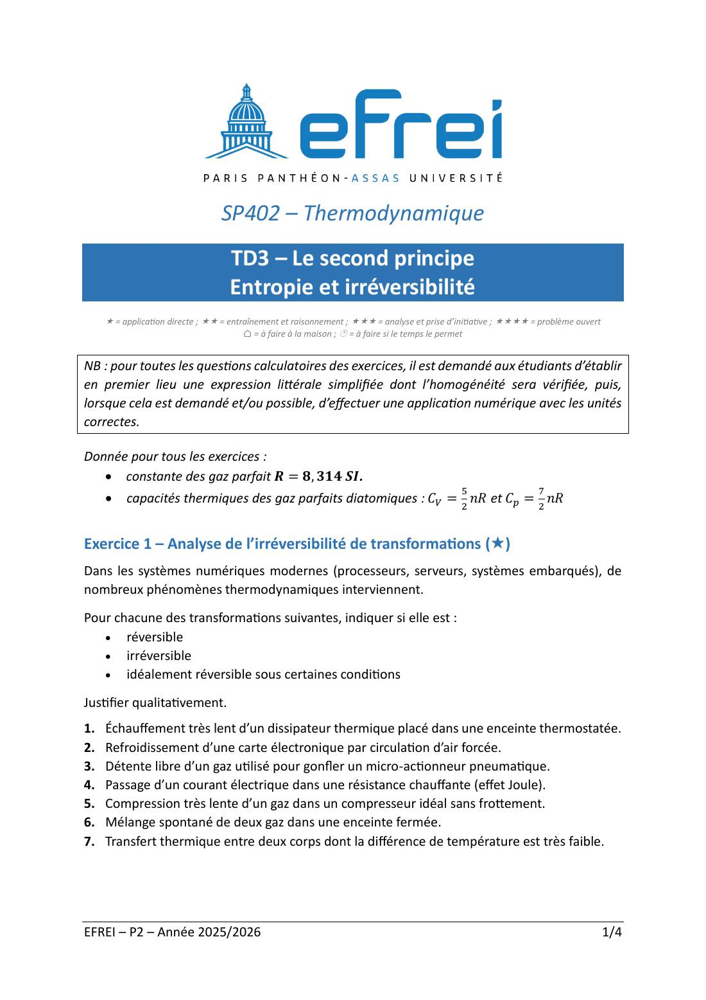
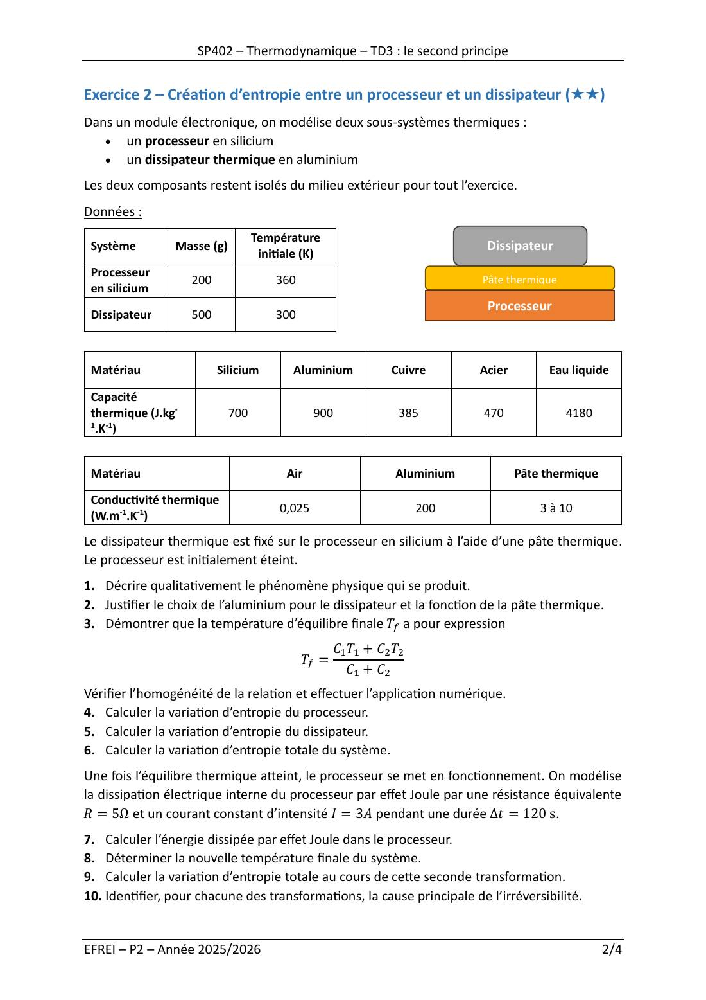
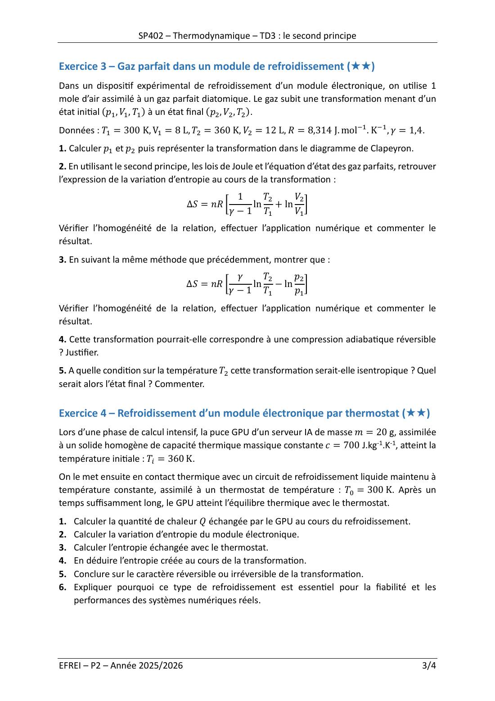
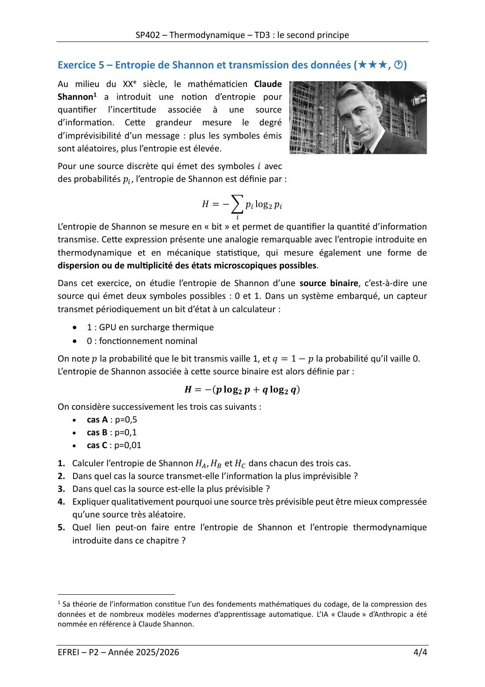

# TD 3 — Le second principe : entropie et irréversibilité

=== "Version simplifiée"

    Rappels : [chapitre 3](../cours/chapitre-3-second-principe.md).

    ## Exercice 1 — Réversible ou pas ?

    | Transformation | Verdict | Pourquoi |
    |---|---|---|
    | 1. Échauffement très lent dans une enceinte thermostatée | idéalement réversible | quasi-statique, écart de $T$ infinitésimal |
    | 2. Refroidissement par air forcé | irréversible | écart de $T$ fini, frottements de l'air |
    | 3. Détente libre d'un gaz | irréversible | pas d'équilibre mécanique, détente brutale |
    | 4. Effet Joule | irréversible | dissipation, jamais l'inverse spontané |
    | 5. Compression très lente sans frottement | idéalement réversible | quasi-statique, sans dissipation |
    | 6. Mélange spontané de deux gaz | irréversible | on ne les « démélange » pas spontanément |
    | 7. Transfert entre corps de $T$ très proches | idéalement réversible (à la limite $\Delta T \to 0$) | |

    ## Exercice 2 — Processeur et dissipateur

    $C_1 = 0{,}2\times700 = 140$ J/K (Si, 360 K) ; $C_2 = 0{,}5\times900 = 450$ J/K (Al, 300 K).

    - L'aluminium conduit très bien la chaleur et coûte peu ; la pâte thermique
      chasse l'air (isolant) entre les surfaces.
    - $T_f = \dfrac{C_1T_1 + C_2T_2}{C_1 + C_2} \approx 314{,}2$ K.
    - $\Delta S_1 = C_1\ln\frac{T_f}{T_1} \approx -19{,}0$ J/K ; $\Delta S_2 = C_2\ln\frac{T_f}{T_2} \approx +20{,}9$ J/K ;
      **$\Delta S = S_c \approx +1{,}8$ J/K > 0** (système isolé, écart de température).
    - Effet Joule : $Q = RI^2\Delta t = 5\times9\times120 = 5{,}4$ kJ →
      $T_f' = T_f + \dfrac{Q}{C_1 + C_2} \approx 323{,}4$ K ;
      $\Delta S = (C_1 + C_2)\ln\frac{T_f'}{T_f} \approx +16{,}9$ J/K, entièrement créée (dissipation par effet Joule).

    ## Exercice 3 — Gaz parfait de 300 K, 8 L à 360 K, 12 L

    - $p_1 = \dfrac{RT_1}{V_1} \approx 3{,}12$ bar ; $p_2 \approx 2{,}49$ bar.
    - $\Delta S = nR\left[\dfrac{1}{\gamma - 1}\ln\dfrac{T_2}{T_1} + \ln\dfrac{V_2}{V_1}\right] \approx +7{,}16$ J/K,
      et la forme en $(T, p)$ donne la même valeur (fonction d'état).
    - Pas une adiabatique réversible : elle serait isentropique ($\Delta S = 0$).
    - Isentropique si $T_2 = T_1(V_1/V_2)^{\gamma - 1} \approx 255$ K : une détente
      adiabatique réversible **refroidit** le gaz.

    ## Exercice 4 — GPU refroidi par un thermostat

    $m = 20$ g, $c = 700$ J/(kg·K), 360 K → 300 K.

    1. $Q = mc(T_0 - T_i) = -840$ J (cédée par le GPU).
    2. $\Delta S = mc\ln\dfrac{T_0}{T_i} \approx -2{,}55$ J/K.
    3. $S_{éch} = \dfrac{Q}{T_0} = -2{,}80$ J/K.
    4. $S_c = \Delta S - S_{éch} \approx +0{,}25$ J/K > 0 : **irréversible**.

    !!! piege "Le signe de $\Delta S$"
        $\Delta S < 0$ pour le GPU n'est pas une violation du second principe :
        le GPU n'est pas isolé. C'est $S_c$ qui doit être positive.

    ## Exercice 5 — Entropie de Shannon

    $H = -(p\log_2p + q\log_2q)$ : $H_A = 1$ bit, $H_B \approx 0{,}47$ bit, $H_C \approx 0{,}08$ bit.
    Le cas A est le plus imprévisible, le cas C le plus prévisible. Une source
    prévisible contient peu d'information par symbole : elle se **compresse** bien.
    Les deux entropies mesurent le **nombre de configurations possibles**
    (micro-états ou messages) : formule $-\sum p_i\ln p_i$ dans les deux cas.

=== "Version papier"

    Énoncé du TD 3 tel qu'il est distribué.

    <!-- papier: pdf/SP402P/2526sp402-td3-secondprincipe.pdf | TD 3 — énoncé | td3 | page -->

    [{ loading=lazy .papier }](papier/td3/p01.jpg)
    
SP402 – Thermodynamique · TD 3 — énoncé, page 1

    [{ loading=lazy .papier }](papier/td3/p02.jpg)
    
SP402 – Thermodynamique – TD3 : le second principe · TD 3 — énoncé, page 2

    [{ loading=lazy .papier }](papier/td3/p03.jpg)
    
SP402 – Thermodynamique – TD3 : le second principe · TD 3 — énoncé, page 3

    [{ loading=lazy .papier }](papier/td3/p04.jpg)
    
SP402 – Thermodynamique – TD3 : le second principe · TD 3 — énoncé, page 4

    <!-- /papier -->
