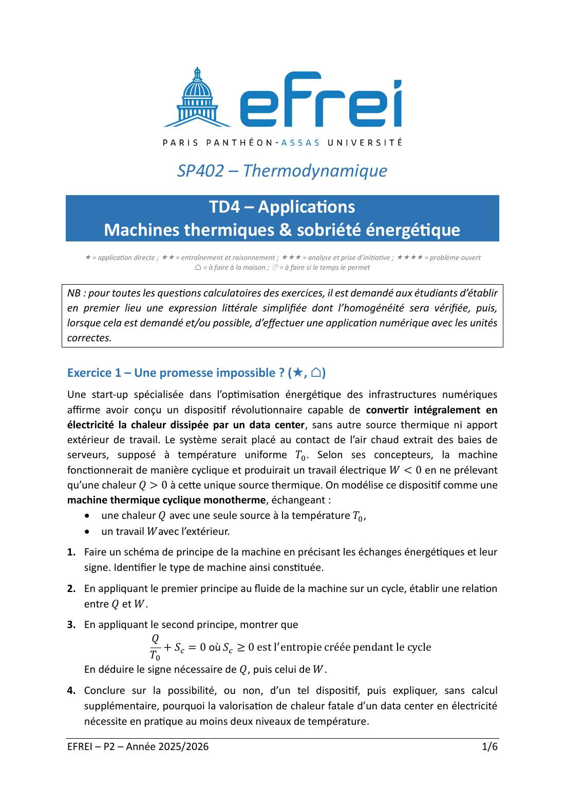
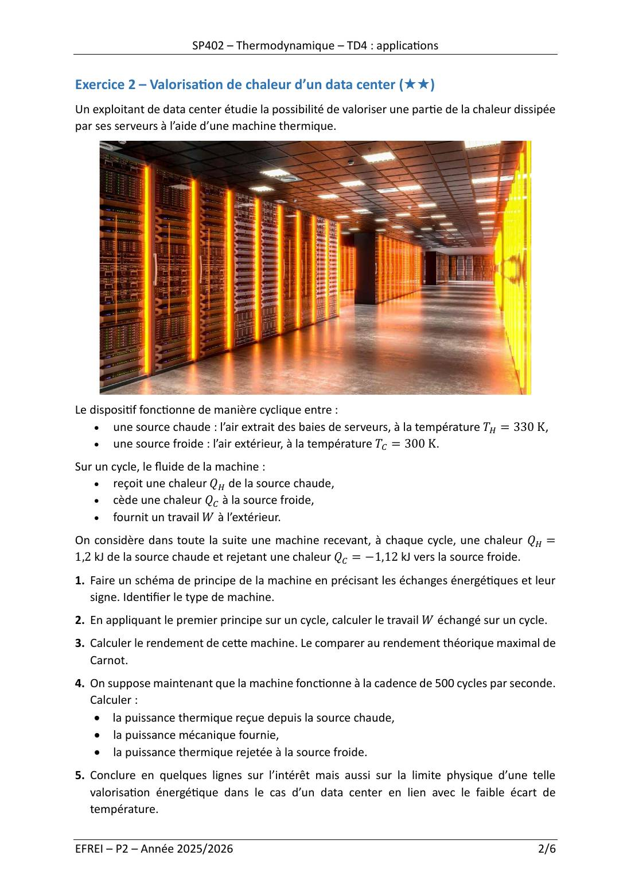
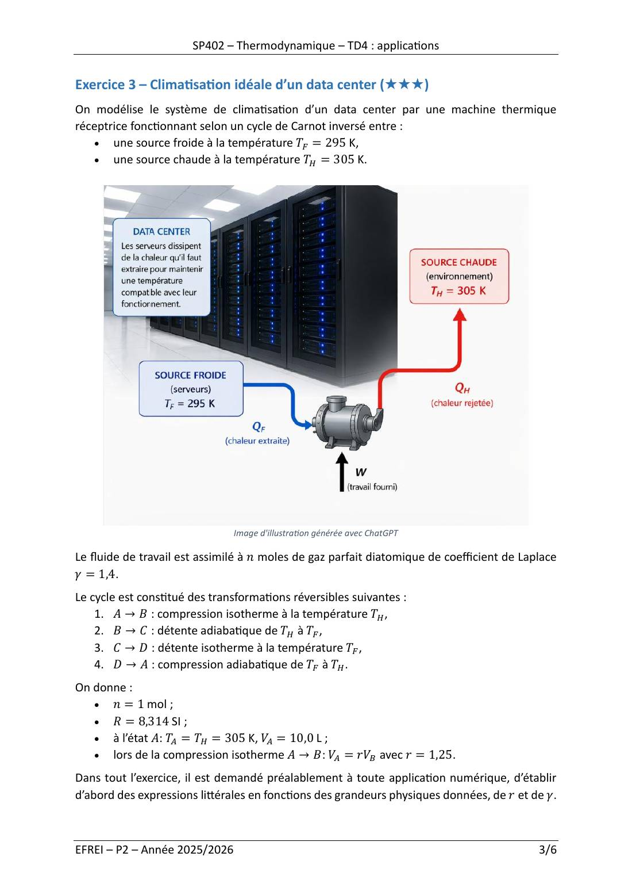
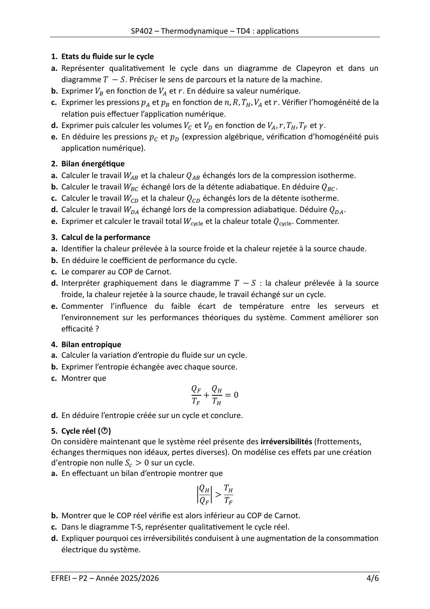
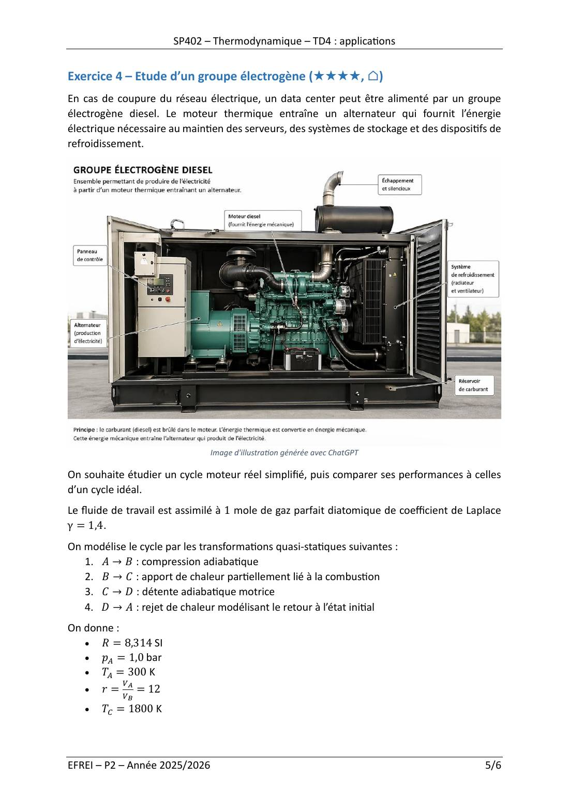
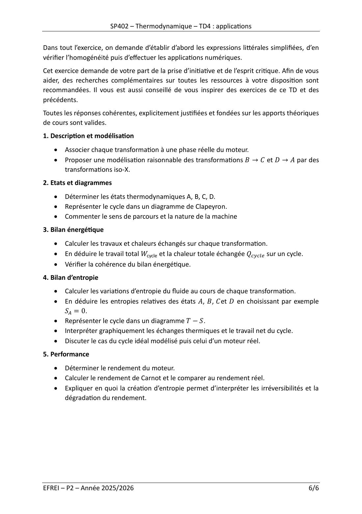

# TD 4 — Machines thermiques et sobriété énergétique

=== "Version simplifiée"

    Rappels : [chapitre 4](../cours/chapitre-4-machines-thermiques.md).

    ## Exercice 1 — Le moteur monotherme de la start-up

    Sur un cycle : $W + Q = 0$ et $\dfrac{Q}{T_0} + S_c = 0$ avec $S_c \ge 0$.
    Donc $Q = -T_0S_c \le 0$ puis $W = -Q \ge 0$ : la machine ne peut **pas**
    fournir de travail. Promesse impossible (Kelvin-Planck) : il faut une source
    froide pour convertir la chaleur fatale.

    ## Exercice 2 — Valorisation de chaleur ($T_H = 330$ K, $T_C = 300$ K)

    - Moteur ditherme ($Q_H > 0$, $Q_C < 0$, $W < 0$).
    - $W = -(Q_H + Q_C) = -80$ J par cycle.
    - $\eta = \dfrac{-W}{Q_H} \approx 6{,}7\,\%$ ; Carnot : $1 - \dfrac{300}{330} \approx 9{,}1\,\%$.
    - À 500 cycles/s : 600 kW reçus, **40 kW** de puissance mécanique, 560 kW rejetés.
    - Le faible écart de température plafonne le rendement à quelques % : mieux
      vaut utiliser cette chaleur directement (chauffage urbain, piscine…).

    ## Exercice 3 — Climatisation par cycle de Carnot inversé ($T_F = 295$ K, $T_H = 305$ K)

    | Point | $V$ (L) | $p$ (bar) | $T$ (K) |
    |---|:-:|:-:|:-:|
    | A | 10,0 | 2,54 | 305 |
    | B | 8,00 | 3,17 | 305 |
    | C | 8,70 | 2,82 | 295 |
    | D | 10,87 | 2,26 | 295 |

    ($V_C = V_B\left(\frac{T_H}{T_F}\right)^{\frac{1}{\gamma - 1}}$, $V_D = V_A\left(\frac{T_H}{T_F}\right)^{\frac{1}{\gamma - 1}}$.)

    - $W_{AB} = nRT_H\ln r \approx +566$ J, $Q_{AB} = -566$ J (rejetée à la source chaude).
    - $W_{BC} = C_V(T_F - T_H) \approx -208$ J, $Q_{BC} = 0$.
    - $W_{CD} = -nRT_F\ln r \approx -547$ J, $Q_{CD} = +547$ J (prise à la source froide).
    - $W_{DA} \approx +208$ J, $Q_{DA} = 0$.
    - $W_{cycle} \approx +18{,}6$ J > 0 : machine **réceptrice** (sens trigonométrique).
    - $COP = \dfrac{Q_{CD}}{W_{cycle}} = \dfrac{T_F}{T_H - T_F} = 29{,}5$, égal au COP de Carnot (cycle réversible).
    - Bilan entropique : $\dfrac{Q_F}{T_F} + \dfrac{Q_H}{T_H} = 0$, donc $S_c = 0$.
    - Avec irréversibilités ($S_c > 0$) : $\left|\dfrac{Q_H}{Q_F}\right| > \dfrac{T_H}{T_F}$, le COP réel
      est plus petit et la consommation électrique augmente.

    ## Exercice 4 — Groupe électrogène diesel ($r = 12$, $T_C = 1800$ K)

    Modélisation raisonnable (cycle Diesel) : **B → C isobare** (combustion
    progressive), **D → A isochore** (échappement).

    - $T_B = T_Ar^{\gamma-1} \approx 811$ K, $p_B = p_Ar^\gamma \approx 32{,}4$ bar.
    - $V_C = V_B\,T_C/T_B \approx 4{,}6$ L ; $T_D = T_C(V_C/V_A)^{\gamma - 1} \approx 917$ K.
    - $Q_{BC} = C_p(T_C - T_B) \approx +28{,}8$ kJ ; $Q_{DA} = C_V(T_A - T_D) \approx -12{,}8$ kJ ;
      $W_{cycle} \approx -16{,}0$ kJ.
    - $\eta \approx 55\,\%$ contre $1 - \frac{300}{1800} \approx 83\,\%$ pour Carnot entre les mêmes
      températures extrêmes : l'écart vient de la création d'entropie lors des
      échanges thermiques avec des écarts de température finis.

    D'autres modélisations sont acceptées si elles sont justifiées (l'énoncé le précise).

=== "Version papier"

    Énoncé du TD 4 tel qu'il est distribué.

    <!-- papier: pdf/SP402P/2526sp402-td4-applications.pdf | TD 4 — énoncé | td4 | page -->

    [{ loading=lazy .papier }](papier/td4/p01.jpg)
    
SP402 – Thermodynamique · TD 4 — énoncé, page 1

    [{ loading=lazy .papier }](papier/td4/p02.jpg)
    
Exercice 2 – Valorisation de chaleur d’un data center () · TD 4 — énoncé, page 2

    [{ loading=lazy .papier }](papier/td4/p03.jpg)
    
Exercice 3 – Climatisation idéale d’un data center () · TD 4 — énoncé, page 3

    [{ loading=lazy .papier }](papier/td4/p04.jpg)
    
1. Etats du fluide sur le cycle · TD 4 — énoncé, page 4

    [{ loading=lazy .papier }](papier/td4/p05.jpg)
    
Exercice 4 – Etude d’un groupe électrogène (, ⌂) · TD 4 — énoncé, page 5

    [{ loading=lazy .papier }](papier/td4/p06.jpg)
    
Dans tout l’exercice, on demande d’établir d’abord les expressions littérales simplifiées,… · TD 4 — énoncé, page 6

    <!-- /papier -->
